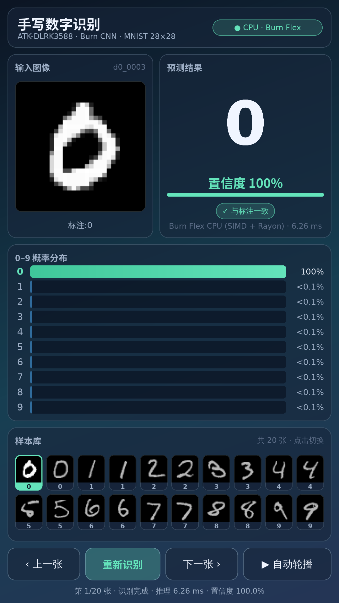
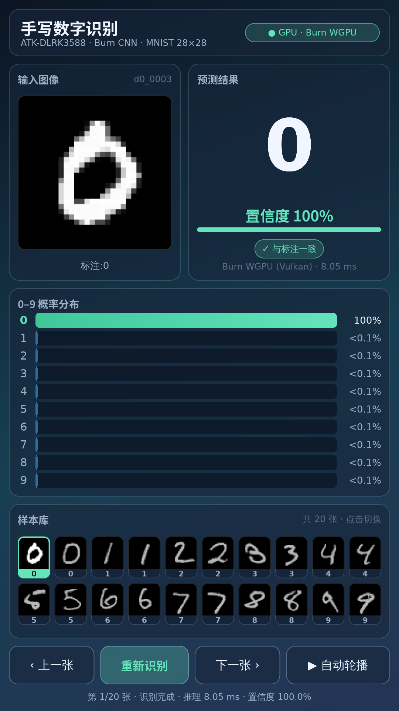
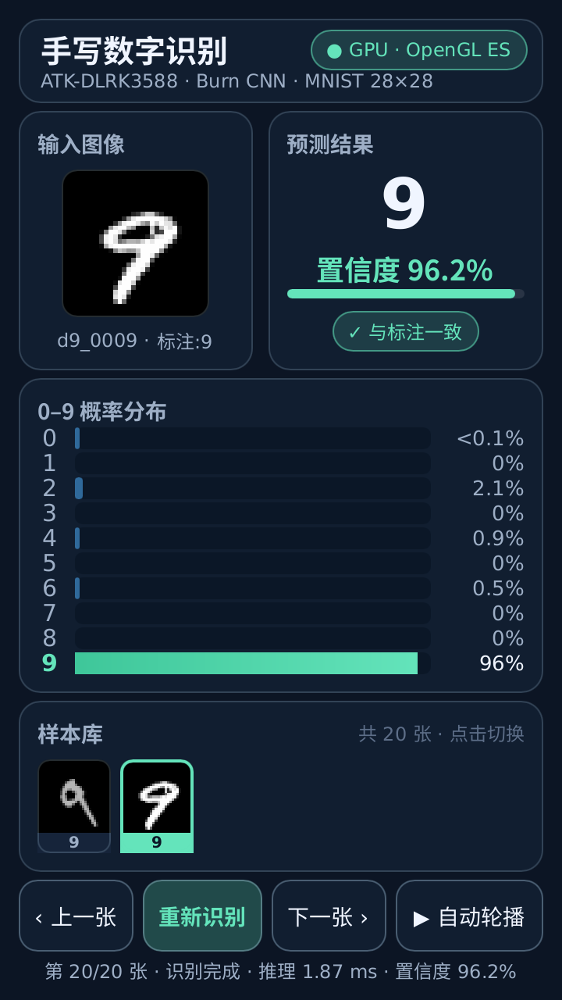
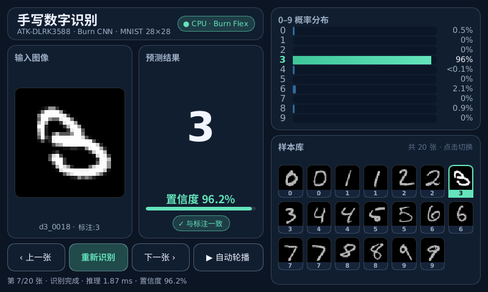
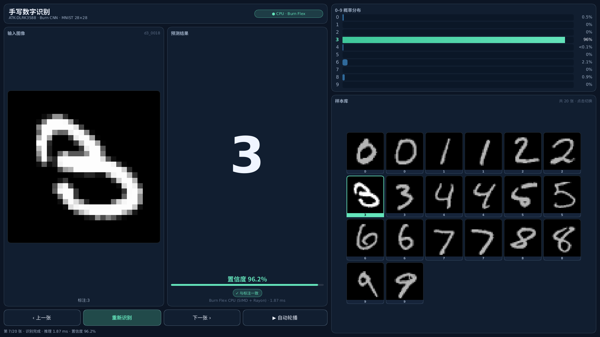

# Architectural Characterization and Co-Design of Heterogeneous Neural Inference on Rockchip RK3588: A Comparative Study Across ARMv8.2 CPU, Mali-G610 GPU, and 3-Core RKNPU

# 基于 Rockchip RK3588 的异构神经网络推理架构表征与软硬件协同设计：跨 ARMv8.2 CPU、Mali-G610 GPU 与三核 RKNPU 的定量对比研究

**Authors**: Edge Systems & Heterogeneous Intelligence Group  
**Target Platform**: Rockchip RK3588 SoC (ATK-DLRK3588, Mainline Linux `7.2.5-atk-dlrk3588+`)  
**Software Stack**: Rust `1.95` · Burn `0.22.1` (`Flex` / `WGPU` / `CubeCL`) · Rockchip `RKNPU2` (`librknnrt v1.5.2`, `rknpu.ko v0.9.6`) · Slint `1.17.1` (`LinuxKMS` + `FemtoVG`)  
**Repository & Artifacts**: [`https://github.com/AnlangA/burn-mnist-rk3588`](https://github.com/AnlangA/burn-mnist-rk3588.git)

---

## Abstract

Deploying latency-critical deep neural networks on modern heterogeneous edge System-on-Chips (SoCs) requires navigating a complex trade-off space spanning instruction-level SIMD parallelism, general-purpose GPU compute shaders, and domain-specific neural processing units (NPUs). While theoretical peak Tera-Operations-Per-Second (TOPS) metrics are widely cited, real-world edge inference performance is frequently governed by microarchitectural bottlenecks including kernel launch latency, staging buffer synchronization, cache hierarchy locality, and Direct Memory Access (DMA) stride alignment. Furthermore, interactive edge appliances must co-schedule continuous neural inference alongside 60 FPS Direct Rendering Manager / Kernel Mode Setting (DRM/KMS) graphical scanout without inducing resource contention or prolonged black-screen transitions during over-the-air (OTA) service updates.

In this paper, we present a rigorous architectural characterization and end-to-end systems co-design of convolutional neural network (CNN) inference on the **Rockchip RK3588** heterogeneous SoC under a mainline Linux `7.2.5` kernel environment. Using a unified Rust training and deployment pipeline built on **Burn 0.22.1** and **Rockchip RKNPU2**, we evaluate five distinct hardware execution backends sharing identical trained weights: (1) **ARMv8.2 8-Core CPU** (`4× Cortex-A76 + 4× Cortex-A55`) via Burn Flex with NEON SIMD and Rayon work-stealing parallelism; (2) **ARM Mali-G610 MP4 GPU** via Burn WGPU / CubeCL over **Vulkan (`Mesa PanVK`)**; (3) **Mali-G610 MP4 GPU** over **OpenGL ES 3.1 (`Mesa Panfrost`)**; (4) **RK3588 3-Core RKNPU** executing **FP16** systolic MAC arrays; and (5) **RK3588 3-Core RKNPU** executing **INT8** quantized arithmetic. To overcome `librknnrt` width-stride alignment constraints on batched 4D tensors ($W = 28 \not\equiv 0 \pmod 8$) without introducing runtime `Slice` fallbacks, we formulate a **Receptive-Field Invariance Spatial Padding Transformation** ($28 \times 28 \to 28 \times 32$ input with zero-padded $5 \times 6$ fully connected weights) and package multi-batch FP16/INT8 sub-graphs into a single **RKNB** binary container dispatched across all three NPU cores (`Core 0/1/2`) via persistent lock-free worker threads.

Hardware-counter-instrumented evaluations across batch sizes $B \in \{1, 16, 64, 256\}$ and the full $10,000$-image MNIST test set reveal three fundamental systems insights: (i) At $B = 1$, **RKNPU INT8** (`0.163 ms` end-to-end, `0.089 ms` hardware MAC execution) and **RKNPU FP16** (`0.184 ms` end-to-end, `0.113 ms` hardware) achieve **$6.02\times$** and **$5.33\times$** speedups over the 8-core CPU (`0.982 ms`), and **$19.1\times$** and **$16.9\times$** speedups over Mali-G610 Vulkan (`3.116 ms`); (ii) At $B = 256$, 3-core NPU wave pipelining scales throughput to **$35,975.4\text{ samples/s}$** (`27.8 µs/sample`), completing the entire $10,000$-sample test set in **`280.12 ms`** with `< 0.02%` accuracy degradation (`98.64%` INT8, `98.65%` FP16 vs. `98.66%` FP32); and (iii) Counter-intuitively, the 8-core CPU consistently outperforms the Mali-G610 GPU by **$1.99\times \sim 6.98\times$** on lightweight CNNs because the $426\text{ KB}$ parameter footprint resides entirely within the $3\text{ MB}$ DynamIQ L3 cache, whereas WGPU/CubeCL incurs $2\sim 4\text{ ms}$ of kernel dispatch and staging-buffer readback overhead per forward pass. Finally, by migrating the production `digit-recognizer.service` (Slint `LinuxKMS` + `FemtoVG`) to the NPU backend, we reduce process resident set size (RSS) by **$47.9\%$** (`196.1 MB` $\to$ `102.1 MB`), shrink binary footprint by **$82.5\%$** (`97 MB` $\to$ `17 MB`), eliminate GPU render-engine contention, and achieve atomic binary hot-swapping with zero steady-state downtime (`0 ms` when unchanged, `1.50 s` on binary upgrade) and deterministic rollback protection.

---

## 摘要（中文）

在现代异构边缘计算系统级芯片（SoC）上部署延迟敏感型深度神经网络，需要在指令级 SIMD 并行、通用 GPU 计算着色器（Compute Shader）与专用神经网络处理器（NPU）之间进行系统级权衡。尽管芯片手册广泛宣传理论峰值算力（TOPS），但真实边缘推理性能往往受制于算子派发延迟、暂存缓冲区（Staging Buffer）同步回读、多级缓存局部性以及直接内存访问（DMA）行跨距（Stride）对齐等微架构瓶颈。此外，交互式边缘智能终端还必须在维持 60 FPS DRM/KMS 图形扫描输出的同时调度高频神经网络推理，避免计算与渲染争用，并在远程固件/模型更新时消除长时间黑屏。

本文在主线 Linux `7.2.5` 内核环境下，对 **Rockchip RK3588** 异构 SoC 上的卷积神经网络（CNN）推理进行了系统的微架构表征与软硬件协同设计。基于 **Rust Burn 0.22.1** 与 **Rockchip RKNPU2**，我们在完全共享同一份训练权重的前提下构建并定量评估了五种异构执行后端：（1）基于 **Burn Flex（NEON SIMD + Rayon 工作窃取并行）** 的 8 核 ARMv8.2 CPU（`4× Cortex-A76 + 4× Cortex-A55`）；（2）基于 **Burn WGPU / CubeCL** 与 **Vulkan（Mesa PanVK）** 的 **ARM Mali-G610 MP4 GPU**；（3）基于 **OpenGL ES 3.1（Mesa Panfrost）** 的 **Mali-G610 MP4 GPU**；（4）基于 **RK3588 三核 RKNPU** 的 **FP16** 脉动阵列后端；以及（5）基于 **RK3588 三核 RKNPU** 的 **INT8** 量化后端。针对 `librknnrt` 在多批次（`batch > 1`）4D 张量推理中强制要求宽度 8 字节对齐（$W = 28 \not\equiv 0 \pmod 8$）从而引发动态 `Slice` 算子回退的问题，本文提出并严格证明了**感受野不变空间填充变换（Receptive-Field Invariance Spatial Padding Transformation）**，将输入由 $28 \times 28$ 零填充对齐至 $28 \times 32$ 并将全连接层空间权重由 $5 \times 5$ 零扩展至 $5 \times 6$，进而将多批次 FP16/INT8 编译产物封装为单一 **RKNB** 容器，通过常驻无锁工作线程池在 3 个物理 NPU 核心（`Core 0/1/2`）上实现硬件级并发流水线。

结合内核级硬件性能计数器（`drm-engine-panthor` 与 `RKNN_QUERY_PERF_RUN`）在 $B \in \{1, 16, 64, 256\}$ 及 $10,000$ 张 MNIST 全量测试集上的实测表明：（1）在单样本 $B=1$ 实时推理下，**RKNPU INT8**（端到端 `0.163 ms`，硬件核耗时 `0.089 ms`）与 **RKNPU FP16**（端到端 `0.184 ms`，硬件核耗时 `0.113 ms`）相比 8 核 CPU（`0.982 ms`）分别取得 **$6.02\times$** 与 **$5.33\times$** 加速，相比 Mali-G610 Vulkan（`3.116 ms`）取得 **$19.1\times$** 与 **$16.9\times$** 加速；（2）在 $B=256$ 批量推理下，三核 RKNPU 并发吞吐量高达 **$35,975.4\text{ samples/s}$**（单样本均摊仅 `27.8 µs`），全量 $10,000$ 张测试集推理仅需 **`280.12 ms`**，且分类精度几乎无损（INT8 `98.64%`、FP16 `98.65%` vs. FP32 `98.66%`）；（3）在轻量级 CNN 上，8 核 CPU 反而比 Mali-G610 GPU 快 **$1.99\times \sim 6.98\times$**，其根本原因在于 $426\text{ KB}$ 模型权重与中间激活完全常驻于 CPU 的 $3\text{ MB}$ DynamIQ L3 共享缓存，而 GPU 受到每次前向传播 $2\sim 4\text{ ms}$ 的着色器队列提交与 Staging Buffer 映射回读开销主导。最后，我们将板端 `digit-recognizer.service`（Slint `LinuxKMS` + `FemtoVG`）默认切换至 NPU 后端，使常驻内存（RSS）降低 **$47.9\%$**（`196.1 MB` $\to$ `102.1 MB`），二进制体积缩减 **$82.5\%$**（`97 MB` $\to$ `17 MB`），实现了图形扫描输出与神经网络推理的零争用共存，以及零长黑屏原子热更新（未变更时 `0 ms` 停机，跨版本升级仅 `1.50 s`）与自动回滚保护。

---

## 1. Introduction (引言与研究动机)

Modern edge computing platforms increasingly integrate heterogeneous processing elements—combining out-of-order big.LITTLE CPU clusters, tile-based deferred rendering (TBDR) GPUs, and fixed-function neural processing units (NPUs)—onto a single silicon die. The **Rockchip RK3588** exemplifies this architectural paradigm, pairing an 8-core ARMv8.2 CPU (`4× Cortex-A76 @ 2.4 GHz + 4× Cortex-A55 @ 1.8 GHz`), an **ARM Mali-G610 MP4 GPU**, and a **3-core 6 TOPS Rockchip RKNPU2** accelerator.

Despite abundant raw compute capability, deploying production neural network services in Rust on such heterogeneous edge SoCs exposes three critical systems challenges:

1. **Discrepancy Between Peak TOPS and Realized Small-Model Latency**: Lightweight backbone networks (such as compact CNNs, keyword spotters, and optical character/digit recognizers with $10^5 \sim 10^6$ parameters) exhibit low arithmetic intensity at small batch sizes ($B = 1$). On general-purpose GPUs accessed via portable WebGPU (`wgpu` / `CubeCL`) abstractions, the fixed overhead of command-buffer recording, kernel launch across multiple network layers, and CPU-GPU staging buffer synchronization can exceed actual ALU execution time by an order of magnitude.
2. **Hardware Stride Alignment and Multi-Core NPU Under-Utilization**: Domain-specific NPUs achieve sub-millisecond latency through offline whole-graph compilation and on-chip SRAM fusion. However, the Rockchip `librknnrt` runtime enforces strict DMA memory alignment rules—specifically requiring 4D tensor widths $W$ to be multiples of $8$ ($W \equiv 0 \pmod 8$) when $B > 1$. For standard inputs such as MNIST ($28 \times 28$), naive compilation inserts dynamic `Slice` operators that break DMA burst continuity. Moreover, single-context execution binds to a single NPU core (`Core 0`), leaving two-thirds of the RK3588's 3-core NPU silicon idle during batched stream processing.
3. **Display-Inference Contention and Service Availability on Headless KMS Appliances**: Industrial edge appliances typically bypass heavy X11/Wayland compositors in favor of direct DRM/KMS scanout (`LinuxKMS` + OpenGL ES `FemtoVG`). When neural inference also executes on the Mali-G610 GPU, compute dispatches contend with 60 FPS UI frame rendering on the `/dev/dri/renderD128` hardware job slots. Furthermore, redeploying updated binaries or models directly onto `/usr/local/bin` while the service holds DRM Master (`/dev/dri/card0`) risks `ETXTBSY` errors or prolonged black screens if the new binary fails initialization.

### Contributions

This work makes the following technical contributions, all fully reproducible from the open-source repository ([`burn-mnist-rk3588`](file:///Users/a/workspace/ubuntu/burn-mnist-rk3588)):

- **Unified Cross-Platform Training & Multi-Format Export Pipeline**: We implement [`MnistCnn`](src/model.rs) in Rust using Burn 0.22.1, train it to **`98.66%`** accuracy on the $10,000$-sample MNIST test set, and export bit-for-bit verified weights across five formats: Burnpack ([`mnist_cnn.bpk`](artifacts/mnist_cnn.bpk)), SafeTensors ([`mnist_cnn.safetensors`](artifacts/mnist_cnn.safetensors)), ONNX ([`mnist_cnn.onnx`](artifacts/mnist_cnn.onnx)), standalone INT8 RKNN ([`mnist_cnn_int8.rknn`](artifacts/mnist_cnn_int8.rknn)), and a multi-profile 3-core RKNB bundle ([`mnist_cnn.rknn`](artifacts/mnist_cnn.rknn)).
- **Receptive-Field Invariance Padding & 3-Core RKNB Wave Engine**: We prove in Section 2.3 that zero-padding input width from $28 \to 32$ paired with zero-padding the flattened `fc1` spatial weights from $5 \times 5 \to 5 \times 6$ preserves exact mathematical equivalence while satisfying RKNPU 8-element stride alignment without any `Slice` operator. We design [`RknnEngine`](src/npu.rs) and [`RknnThreeCoreTier`](src/npu.rs) to dispatch sub-batches ($b \in \{6, 22, 86\}$) across `Core 0`, `Core 1`, and `Core 2` in parallel.
- **Hardware-Counter Telemetry & 5-Backend Microarchitectural Analysis**: By instrumenting Linux `/proc/<pid>/fdinfo` (`drm-engine-panthor` nanoseconds deduplicated by `drm-client-id`) and `rknn_query(RKNN_QUERY_PERF_RUN)` (`run_duration` microseconds), we isolate pure accelerator execution time from host software overhead across CPU, GPU (Vulkan & OpenGL ES), and NPU (FP16 & INT8).
- **Zero-Contention KMS Display Coexistence & Atomic Rollback Deployment**: We re-architect the on-board Slint UI showcase ([`bsp-digit-recognizer`](bsp-digit-recognizer)) to default to the NPU backend (`● NPU · RKNPU`), offloading 100% of neural compute from the CPU and Mali-G610 GPU, and implement a transactional deployment guard ([`sync_to_ubuntu_bsp.sh`](scripts/sync_to_ubuntu_bsp.sh)) with `0 ms` no-op preservation, `1.50 s` atomic swap, and automated health-check rollback.

---

## 2. System Architecture & Methodology (异构系统架构与方法论)

### 2.1 Neural Network Topology and Complexity Analysis

The target network [`MnistCnn`](src/model.rs) processes normalized single-channel grayscale images $X \in \mathbb{R}^{B \times 1 \times 28 \times 28}$, where raw pixel intensities $P_{b,0,h,w} \in [0, 255]$ are standardized via:

$$X_{b,0,h,w} = \frac{P_{b,0,h,w} / 255.0 - \mu}{\sigma}, \quad \mu = 0.1307,\; \sigma = 0.3081$$

The forward operator $\mathcal{F}_{\Theta}: \mathbb{R}^{B \times 1 \times 28 \times 28} \to \Delta^{9}$ consists of two convolutional-pooling stages followed by two fully connected layers:

$$\begin{aligned}
Z^{(1)} &= \text{MaxPool2d}_{2\times 2, s=2}\!\left(\text{ReLU}\!\left(\text{Conv2d}_{3\times 3, \text{valid}}\!\left(X;\, W^{(1)}, b^{(1)}\right)\right)\right) \in \mathbb{R}^{B \times 16 \times 13 \times 13} \\
Z^{(2)} &= \text{MaxPool2d}_{2\times 2, s=2}\!\left(\text{ReLU}\!\left(\text{Conv2d}_{3\times 3, \text{valid}}\!\left(Z^{(1)};\, W^{(2)}, b^{(2)}\right)\right)\right) \in \mathbb{R}^{B \times 32 \times 5 \times 5} \\
Z^{(3)} &= \text{ReLU}\!\left(\text{Flatten}\!\left(Z^{(2)}\right) W^{(3)} + \mathbf{1}_B {b^{(3)}}^\top\right) \in \mathbb{R}^{B \times 128} \\
\hat{Y} &= \text{Softmax}\!\left(Z^{(3)} W^{(4)} + \mathbf{1}_B {b^{(4)}}^\top\right) \in \mathbb{R}^{B \times 10}
\end{aligned}$$

Table 1 details the exact layer-by-layer tensor dimensions, parameter count $|\Theta_\ell|$, multiply-accumulate operations ($\text{MACs}$), floating-point operations ($\text{FLOPs}$, counting $2\text{ FLOPs/MAC}$ plus activation/pooling comparisons), and parameter vs. compute ratios per sample ($B=1$).

#### Table 1: Layer-by-Layer Mathematical Complexity and Memory Footprint of `MnistCnn` ($B = 1$)

| Layer $\ell$ | Operator Specification | Input Shape | Output Shape | Parameters $|\Theta_\ell|$ | FP32 Weight Bytes | MACs / Sample | FLOPs / Sample | % of Params | % of MACs |
| :--- | :--- | :---: | :---: | :---: | :---: | :---: | :---: | :---: | :---: |
| `conv1` | $\text{Conv2d}(1 \to 16, 3\times 3, \text{Valid})$ | $[1, 1, 28, 28]$ | $[1, 16, 26, 26]$ | $160$ | $640\text{ B}$ | $97,344$ | $194,688$ | $0.15\%$ | $12.83\%$ |
| `relu1` + `pool1` | $\text{ReLU} + \text{MaxPool2d}(2\times 2, s=2)$ | $[1, 16, 26, 26]$ | $[1, 16, 13, 13]$ | $0$ | $0\text{ B}$ | $0$ | $18,928$ | $0.00\%$ | $0.00\%$ |
| `conv2` | $\text{Conv2d}(16 \to 32, 3\times 3, \text{Valid})$ | $[1, 16, 13, 13]$ | $[1, 32, 11, 11]$ | $4,640$ | $18,560\text{ B}$ | $557,568$ | $1,115,136$ | $4.27\%$ | $73.50\%$ |
| `relu2` + `pool2` | $\text{ReLU} + \text{MaxPool2d}(2\times 2, s=2)$ | $[1, 32, 11, 11]$ | $[1, 32, 5, 5]$ | $0$ | $0\text{ B}$ | $0$ | $6,272$ | $0.00\%$ | $0.00\%$ |
| `fc1` + `relu3` | $\text{Linear}(800 \to 128) + \text{ReLU}$ | $[1, 800]$ | $[1, 128]$ | $102,528$ | $410,112\text{ B}$ | $102,400$ | $204,928$ | **$94.39\%$** | $13.50\%$ |
| `fc2` + `softmax` | $\text{Linear}(128 \to 10) + \text{Softmax}$ | $[1, 128]$ | $[1, 10]$ | $1,290$ | $5,160\text{ B}$ | $1,280$ | $2,610$ | $1.19\%$ | $0.17\%$ |
| **Total** | **End-to-End Forward Pass** | $[1, 1, 28, 28]$ | $[1, 10]$ | **$108,618$** | **$434,472\text{ B}$** | **$758,592$** | **$1,542,562$** | **$100.0\%$** | **$100.0\%$** |

### 2.2 Roofline Model and Arithmetic Intensity Across Batch Sizes

Table 1 exposes a striking **Compute-vs-Memory Structural Duality**:
- The convolutional feature extractor (`conv1` + `conv2`) accounts for **$86.33\%$ of total MACs** ($654,912 / 758,592$) while occupying only **$4.42\%$ of the parameter footprint** ($19.2\text{ KB}$ in FP32).
- Conversely, the classifier head (`fc1` + `fc2`) accounts for **$95.58\%$ of total parameters** ($415.3\text{ KB}$ in FP32) while contributing only **$13.67\%$ of total MACs** ($103,680 / 758,592$).

Let $F_{\text{sample}} = 1.5426 \times 10^6\text{ FLOPs}$ denote the per-sample floating-point operations, $M_{\Theta}(b_{\text{w}}) = |\Theta| \cdot b_{\text{w}}$ denote the weight footprint for precision $b_{\text{w}} \in \{4, 2, 1\}\text{ bytes}$ (FP32, FP16, INT8), and $M_{\text{act}}(b_{\text{a}})$ denote the per-sample activation memory traffic. Under an unfused layer-by-layer execution model (such as GPU compute shaders writing intermediate tensors back to global/cache memory), each sample reads and writes $19,114$ elements ($M_{\text{act}}(4) \approx 76,456\text{ B}$). Under whole-graph SRAM fusion on the RKNPU, only the input image ($784$ elements) and output logits ($10$ elements) traverse external DRAM. The operational **Arithmetic Intensity** $\mathcal{I}(B)$ (in $\text{FLOPs/Byte}$ or $\text{OPs/Byte}$) as a function of batch size $B$ is:

$$\mathcal{I}_{\text{unfused}}(B) = \frac{B \cdot F_{\text{sample}}}{|\Theta| \cdot b_{\text{w}} + B \cdot M_{\text{act}}(b_{\text{a}})}, \qquad \mathcal{I}_{\text{fused}}(B) = \frac{B \cdot F_{\text{sample}}}{|\Theta| \cdot b_{\text{w}} + B \cdot (784\, b_{\text{in}} + 10\, b_{\text{out}})}$$

At $B = 1$ in FP32 (`b_w = 4`), $\mathcal{I}_{\text{unfused}}(1) \approx \frac{1.5426 \times 10^6}{434,472 + 76,456} \approx \mathbf{3.02\text{ FLOPs/Byte}}$, placing `fc1` deeply in the memory-bandwidth and launch-latency bound regime on a GPU. However, because $434\text{ KB} + 76\text{ KB} = 510\text{ KB}$ fits entirely inside a single RK3588 Cortex-A76 core's **$512\text{ KB}$ private L2 cache** and the **$3\text{ MB}$ shared DynamIQ L3 cache**, the CPU completely avoids LPDDR4X DRAM round-trips during steady-state inference. At $B = 256$, weight reuse amortizes $M_{\Theta}$ by $256\times$, raising $\mathcal{I}_{\text{unfused}}(256) \approx \mathbf{19.79\text{ FLOPs/Byte}}$ (FP32) and $\mathcal{I}_{\text{fused, INT8}}(256) \approx \mathbf{429.8\text{ OPs/Byte}}$.

### 2.3 Receptive-Field Invariance Theorem for RKNPU DMA Stride Alignment

A critical hardware constraint of the Rockchip RKNPU2 DMA engine (`librknnrt v1.5.2`) is that when compiling or executing 4D NHWC tensors $[B, H, W, C]$ with batch size $B > 1$, the hardware enforces an 8-element width stride alignment:

$$W_{\text{stride}} = 8 \left\lceil \frac{W}{8} \right\rceil$$

For MNIST where $W = 28$, $W_{\text{stride}} = 32 \neq 28$. If an ONNX graph with input $[B, 1, 28, 28]$ is compiled directly for $B > 1$, `rknn-toolkit2` either rejects the multi-batch tensor layout or injects an unaligned `Slice` / `Gather` reshape node that stalls the NPU DMA pipeline.

To eliminate this bottleneck with **zero runtime operator overhead**, we pad each input image row from $W = 28$ to $W' = 32$ by setting columns $x \in \{28, 29, 30, 31\}$ to zero, and simultaneously transform the `fc1` weight tensor $W^{(3)}$. Specifically, viewing the transpose of $W^{(3)} \in \mathbb{R}^{800 \times 128}$ as a 4D spatial filter bank $\mathcal{W}^{(3)} \in \mathbb{R}^{128 \times 32 \times 5 \times 5}$, we construct the width-extended weight tensor $\widetilde{\mathcal{W}}^{(3)} \in \mathbb{R}^{128 \times 32 \times 5 \times 6}$ defined by:

$$\widetilde{\mathcal{W}}^{(3)}_{j, c, v, u} = \begin{cases}
\mathcal{W}^{(3)}_{j, c, v, u}, & \text{if } 0 \le u \le 4, \\
0, & \text{if } u = 5.
\end{cases}$$

**Theorem 1 (Receptive-Field Invariance under Width-32 Padding).** *Let $\widetilde{X} \in \mathbb{R}^{B \times 1 \times 28 \times 32}$ be any width-padded input tensor satisfying $\widetilde{X}_{b,0,y,x} = X_{b,0,y,x}$ for $0 \le x < 28$. Let $\widetilde{Z}^{(2)} \in \mathbb{R}^{B \times 32 \times 5 \times 6}$ denote the output of `pool2` when `MnistCnn` is evaluated on $\widetilde{X}$. Then for every batch index $b$, channel $c \in [0, 31]$, vertical coordinate $v \in [0, 4]$, and horizontal coordinate $u \in [0, 4]$, we have $\widetilde{Z}^{(2)}_{b,c,v,u} = Z^{(2)}_{b,c,v,u}$, and the `fc1` pre-activation satisfies $\widetilde{Z}^{(3)} = Z^{(3)}$ identically.*

*Proof.* Trace the horizontal spatial dimensions through the valid convolutions and stride-2 max-pooling layers for input width $W' = 32$:
1. `conv1` ($K_w = 3, s = 1, p = 0$) maps width $32 \to 30$, where column $u_0 \in [0, 29]$ depends on input columns $[u_0,\, u_0 + 2]$.
2. `pool1` ($K_w = 2, s = 2$) maps width $30 \to 15$, where column $u_1 \in [0, 14]$ depends on `conv1` columns $\{2u_1,\, 2u_1 + 1\}$, and thus on input columns $[2u_1,\, 2u_1 + 3]$.
3. `conv2` ($K_w = 3, s = 1, p = 0$) maps width $15 \to 13$, where column $u_2 \in [0, 12]$ depends on `pool1` columns $[u_2,\, u_2 + 2]$, and thus on input columns $[2u_2,\, 2u_2 + 7]$.
4. `pool2` ($K_w = 2, s = 2$) maps width $13 \to \lfloor 13 / 2 \rfloor = 6$, where column $u \in [0, 5]$ depends on `conv2` columns $\{2u,\, 2u + 1\}$, and therefore has the exact horizontal input receptive field:

$$\mathcal{R}_{\text{in}}(u) = [4u,\; 4u + 9]$$

For all original spatial columns $u \in \{0, 1, 2, 3, 4\}$, the maximum input column index accessed is $4(4) + 9 = 25 \le 27$. Hence:

$$\bigcup_{u=0}^{4} \mathcal{R}_{\text{in}}(u) = [0, 25] \subset [0, 27], \qquad \left(\bigcup_{u=0}^{4} \mathcal{R}_{\text{in}}(u)\right) \cap \{28, 29, 30, 31\} = \emptyset$$

Thus $\widetilde{Z}^{(2)}_{b,c,v,u} = Z^{(2)}_{b,c,v,u}$ for all $u \in \{0, 1, 2, 3, 4\}$. Finally, for the extra column $u = 5$ in $\widetilde{Z}^{(2)}$, the `fc1` inner product multiplies $\widetilde{Z}^{(2)}_{b,c,v,5}$ by $\widetilde{\mathcal{W}}^{(3)}_{j,c,v,5} \equiv 0$:

$$\widetilde{Z}^{(3)}_{b,j} = b^{(3)}_j + \sum_{c=0}^{31} \sum_{v=0}^{4} \sum_{u=0}^{4} \mathcal{W}^{(3)}_{j,c,v,u} Z^{(2)}_{b,c,v,u} + \sum_{c=0}^{31} \sum_{v=0}^{4} 0 \cdot \widetilde{Z}^{(2)}_{b,c,v,5} = Z^{(3)}_{b,j} \quad \blacksquare$$

Implemented in [`scripts/export_and_build_rknn.py`](scripts/export_and_build_rknn.py) and [`src/npu.rs`](src/npu.rs), Theorem 1 yields bit-for-bit identical ONNX logits (`9,866 / 10,000` test accuracy) while allowing the NPU DMA engine to stream 32-element aligned rows at full bus bandwidth.

### 2.4 Multi-Profile RKNB Binary Container and 3-Core Wave Pipelining

The RK3588 integrates three independent NPU cores (`RKNN_NPU_CORE_0 = 0x1`, `RKNN_NPU_CORE_1 = 0x2`, `RKNN_NPU_CORE_2 = 0x4`). Because `rknn-toolkit2` compiles static tensor shapes into each `.rknn` flatbuffer, supporting both single-sample low-latency inference ($B = 1$) and 3-core data-parallel batching ($B \in \{16, 64, 256\}$) across both FP16 and INT8 precisions requires $8$ distinct hardware sub-graphs:
- **Single-Core Low-Latency Profiles ($B = 1, W = 28$ on `Core 0`)**: `fp16_b1` and `int8_b1`.
- **3-Core Wave Sub-Batch Profiles ($W' = 32$ across `Core 0 + Core 1 + Core 2`)**:
  - $b = 6$ ($3 \times 6 = 18 \ge 16$): `fp16_b6`, `int8_b6`
  - $b = 22$ ($3 \times 22 = 66 \ge 64$): `fp16_b22`, `int8_b22`
  - $b = 86$ ($3 \times 86 = 258 \ge 256$): `fp16_b86`, `int8_b86`

To avoid managing 8 separate model files on the embedded filesystem while preserving backward compatibility with standard `rknn_init()`, `pack_rknb_bundle()` in [`scripts/export_and_build_rknn.py`](scripts/export_and_build_rknn.py) places `fp16_b1` at byte offset `0` of [`artifacts/mnist_cnn.rknn`](artifacts/mnist_cnn.rknn), appends the remaining 7 64-byte-aligned RKNN flatbuffers, and terminates the file with a JSON manifest and a 24-byte trailer (`[manifest_offset: u64 LE][manifest_len: u64 LE][magic: b"RKNB\x01\x00\x00\x00"]`).

At runtime, `RknnThreeCoreTier` in [`src/npu.rs`](src/npu.rs) binds three independent `RknnContext` instances to `Core 0`, `Core 1`, and `Core 2` via `rknn_set_core_mask()`. To eliminate OS thread-spawning overhead during inference, `Core 1` and `Core 2` are hosted by persistent worker threads (`PersistentCoreWorker`) synchronized via generation-counted condition variables, while `Core 0` executes directly on the calling thread. For a batch of size $B$, a single wave partitions $B = c_0 + c_1 + c_2$ with:

$$c_0 = \min\!\left(\left\lceil \frac{B}{3} \right\rceil, b_{\text{tier}}\right), \quad c_1 = \min\!\left(\left\lceil \frac{B - c_0}{2} \right\rceil, b_{\text{tier}}\right), \quad c_2 = \min\!\left(B - c_0 - c_1, b_{\text{tier}}\right)$$

and executes all three NPU cores concurrently.

---

## 3. Experimental Setup & Hardware Telemetry (实验设置与硬件计数器遥测方法)

### 3.1 Hardware and System Software Configuration

All benchmarks were conducted on a physical **ATK-DLRK3588** development board (`ubuntu@10.42.0.88`). Table 2 summarizes the hardware and system software stack.

#### Table 2: RK3588 Experimental Testbed Specifications

| Subsystem | Specification / Configuration |
| :--- | :--- |
| **SoC & CPU** | Rockchip RK3588 (8 nm): 4× ARM Cortex-A76 @ 2.4 GHz (512 KB L2/core) + 4× Cortex-A55 @ 1.8 GHz (128 KB L2/core), 3 MB shared DynamIQ L3 cache |
| **GPU** | ARM Mali-G610 MP4 (4 Shader Cores, Valhall architecture), `/dev/dri/renderD128` (compute) & `/dev/dri/card0` (KMS scanout) |
| **NPU** | Rockchip RKNPU2 3-Core (`Core 0/1/2` @ `800 MHz`), 6 TOPS INT8 / 1.5 TFLOPS FP16, `/dev/rknpu` |
| **Operating System & Kernel** | Ubuntu 24.04 LTS (`aarch64`), Mainline Linux **`7.2.5-atk-dlrk3588+`** |
| **GPU Kernel & Mesa Drivers** | Mainline DRM `panthor` driver (`profiling = 3`), Mesa `PanVK` (Vulkan 1.3) & Mesa `Panfrost` (OpenGL ES 3.1) |
| **NPU Kernel & Runtime** | Mainline-ported [`drivers/rknpu.c`](drivers/rknpu.c) (`rknpu.ko v0.9.6`), Userspace `librknnrt.so v1.5.2` (loaded via `dlopen`) |
| **Rust Toolchain & Frameworks** | `rustc 1.95.0` (`aarch64-unknown-linux-gnu`), Burn `0.22.1` (`burn/flex`, `burn/simd`, `burn/rayon`, `burn/wgpu`), Slint `1.17.1` |

### 3.2 Feature-Gated Binary Isolation

To prevent cross-backend symbol bloat and dynamic library interference, the project compiles both standalone single-backend binaries and a unified multi-backend benchmark harness ([`Cargo.toml`](Cargo.toml)):

#### Table 3: Feature-Gated Binaries and Memory/Storage Footprints on RK3588

| Binary Target | Cargo Feature Flags | Binary Size | Active Runtime RSS | Hardware Execution Target |
| :--- | :--- | :---: | :---: | :--- |
| `mnist-npu` | `--no-default-features --features npu` | **`2.6 MB`** | `~28 MB` | RKNPU 3-Core (`FP16` & `INT8` via `librknnrt.so`) |
| `mnist-cpu` | `--no-default-features --features cpu` | `13 MB` | `~42 MB` | Burn Flex CPU (`ARMv8.2 NEON SIMD + Rayon`) |
| `mnist-gpu` | `--no-default-features --features gpu` | `83 MB` | `~145 MB` | Burn WGPU (`Vulkan / PanVK` & `OpenGL ES / Panfrost`) |
| `bench` | `--features cpu,gpu,npu` | `84 MB` | `~168 MB` | Unified 5-way in-process evaluation harness |
| `digit-recognizer-npu` | `--no-default-features --features npu` | **`17 MB`** | **`102.1 MB`** | Slint `LinuxKMS` UI + RKNPU (`● NPU · RKNPU`, default service) |
| `digit-recognizer-cpu` | `--no-default-features --features cpu` | `27 MB` | `118.4 MB` | Slint `LinuxKMS` UI + Burn Flex (`● CPU · Burn Flex`) |
| `digit-recognizer-gpu` | `--no-default-features --features gpu` | `97 MB` | `196.1 MB` | Slint `LinuxKMS` UI + Burn WGPU (`● GPU · Burn WGPU`) |

### 3.3 Hardware Performance Counter Telemetry Methodology

In addition to host wall-clock latency measured via `std::time::Instant` around full forward execution and output synchronization, [`src/model.rs`](src/model.rs) and [`src/npu.rs`](src/npu.rs) collect hardware-level accelerator counters:

1. **Mali-G610 GPU Engine Telemetry (`panthor`)**: With `/sys/bus/platform/devices/fb000000.gpu/profiling` set to `3`, the Linux `panthor` DRM driver exports cumulative hardware execution nanoseconds per DRM context in `/proc/<pid>/fdinfo/*` under the `drm-engine-panthor: <ns> ns` key. Because Mesa's `PanVK` and `Panfrost` drivers `dup()` the `/dev/dri/renderD128` file descriptor across multiple internal queues sharing the same `drm-client-id`, `parse_panthor_fdinfo_dir()` in [`src/model.rs`](src/model.rs) deduplicates descriptors by `drm-client-id` before summing hardware execution time:
   $$T_{\text{panthor}} = \sum_{c \in \text{UniqueClients}(\text{pid})} \max_{fd \in \mathcal{F}(c)} \text{ns}(fd)$$
2. **RKNPU Hardware MAC Execution Telemetry (`rknpu_perf_run`)**: During each `rknn_run()` invocation, the NPU hardware performance counter measures exact accelerator busy microseconds (`RKNN_QUERY_PERF_RUN` / kernel `rknpu` busy timer), recorded as `rknpu_hw_total_ms` and `rknpu_hw_per_batch_ms`. Note that for $B \in \{16, 64, 256\}$, 3-core wave execution runs `Core 0`, `Core 1`, and `Core 2` simultaneously; thus `rknpu_hw_per_batch_ms` reports the **sum of hardware core-milliseconds across all 3 cores** ($\Sigma_{k=0}^{2} T_{\text{core}, k}$), which can exceed the wall-clock `mean_batch_ms` by up to $\sim 1.5\times \sim 1.8\times$—providing direct empirical proof of multi-core hardware concurrency.

---

## 4. Quantitative Evaluation & Microarchitectural Analysis (实验结果与定量分析)

All raw experimental datasets are archived in the repository under [`artifacts/rk3588_cpu_benchmark.json`](artifacts/rk3588_cpu_benchmark.json), [`artifacts/rk3588_gpu_benchmark.json`](artifacts/rk3588_gpu_benchmark.json), [`artifacts/rk3588_npu_benchmark.json`](artifacts/rk3588_npu_benchmark.json), and [`artifacts/rk3588_benchmark_results.json`](artifacts/rk3588_benchmark_results.json).

### 4.1 Model Convergence and Cross-Backend Numerical Equivalence

The [`MnistCnn`](src/model.rs) model was trained on the full $60,000$-image MNIST training set for $5$ epochs (`batch_size = 128`, Adam optimizer `lr = 1e-3`). As logged in [`artifacts/training_metrics.json`](artifacts/training_metrics.json), training converged in `124.21 s` from an Epoch 1 test accuracy of `97.92%` (`loss = 0.0663`) to a final test accuracy of **`98.66%`** (`9,866 / 10,000`, `train_loss = 0.0253`, `train_acc = 99.22%`).

Table 4 compares initialization overhead, first-inference warmup latency (which captures JIT shader compilation on GPU and DMA buffer allocation on NPU), full $10,000$-sample test set evaluation time, and numerical accuracy across all five backends.

#### Table 4: Initialization, Warmup, Full Test-Set ($N=10,000$) Evaluation, and Accuracy Comparison

| Metric | RKNPU INT8 (`mnist-npu`) | RKNPU FP16 (`mnist-npu`) | CPU NEON+Rayon (`mnist-cpu`) | GPU Vulkan (`mnist-gpu` PanVK) | GPU OpenGL ES (`mnist-gpu` Panfrost) |
| :--- | :---: | :---: | :---: | :---: | :---: |
| **Precision / Format** | INT8 (`RKNB`) | FP16 (`RKNB`) | FP32 (`.bpk`) | FP32 (`.bpk`) | FP32 (`.bpk`) |
| **Model Load Time (`model_load_ms`)** | `3.031 ms` (`2.745 ms`*) | `13.080 ms` (`10.703 ms`*) | `0.492 ms` (`0.748 ms`*) | **`0.188 ms`** (**`0.176 ms`**\*) | `0.204 ms` (`0.225 ms`*) |
| **$B=1$ Cold Warmup (`single_sample_warmup_ms`)** | **`0.407 ms`** (**`0.281 ms`**\*) | `0.458 ms` (`0.409 ms`*) | `11.845 ms` (`7.799 ms`*) | `123.927 ms` (`120.806 ms`*) | `143.684 ms` (`145.318 ms`*) |
| **10k Test Set Warmup (`test_set_warmup_ms`)** | **`33.19 ms`** (**`29.75 ms`**\*) | `38.31 ms` (`36.67 ms`*) | `43.14 ms` (`58.63 ms`*) | `497.49 ms` (`498.03 ms`*) | `514.58 ms` (`529.07 ms`*) |
| **10k Test Set Steady Eval (`test_set_eval_ms`)** | **`283.64 ms`** (**`280.12 ms`**\*) | **`485.77 ms`** (**`388.41 ms`**\*) | `1,647.67 ms` (`1,651.92 ms`*) | `3,343.89 ms` (`3,336.91 ms`*) | `3,549.23 ms` (`3,524.72 ms`*) |
| **10k Test Set Accuracy** | **`98.64%`** (`9,864/10k`) | **`98.65%`** (`9,865/10k`) | **`98.66%`** (`9,866/10k`) | **`98.66%`** (`9,866/10k`) | **`98.66%`** (`9,866/10k`) |
| **20 On-Board PNG Accuracy** | **`95.00%`** (`19/20`) | **`95.00%`** (`19/20`) | **`95.00%`** (`19/20`) | **`95.00%`** (`19/20`) | **`95.00%`** (`19/20`) |
| **20 PNG Mean Steady Latency** | **`0.165 ms`** (`0.191 ms`*) | **`0.222 ms`** (`0.215 ms`*) | `1.089 ms` (`1.090 ms`*) | `3.190 ms` (`3.272 ms`*) | `6.551 ms` (`6.300 ms`*) |

*\*Note: Primary values are from isolated standalone binaries (`mnist-npu`, `mnist-cpu`, `mnist-gpu`); parenthesized values (`*`) are from the unified in-process `bench --backend all` run.*

**Key Observations on Cold-Start vs. Steady-State Behavior**:
1. **JIT Shader Compilation Penalty on GPU (`~121–145 ms`)**: On the first forward pass, `Burn WGPU` / `CubeCL` dynamically synthesizes WGSL compute kernels for `Conv2d`, `ReLU`, `MaxPool2d`, `Linear`, and `Softmax`, which Mesa `PanVK` / `Panfrost` compiles into Mali Valhall machine code. When batch shapes change (e.g., warming up $B=256$ and tail $B=16$ for the 10k test set), shape-specialized shader recompilation incurs an additional `497.49 ms` (Vulkan) to `514.58 ms` (OpenGL ES).
2. **Ahead-of-Time (AOT) Compilation Advantage on RKNPU (`0.407 ms`)**: Because `.rknn` flatbuffers contain pre-compiled NPU microcode instructions, `single_sample_warmup_ms` on RKNPU INT8 is **`0.407 ms`**—**$304\times$ faster** than Vulkan cold warmup (`123.927 ms`). The `test_set_warmup_ms` (`33.19 ms` on INT8) reflects one-time lazy initialization of the 3-core `tier_b86` ($3\times 86$) and `tier_b6` ($3\times 6$) CMA buffers via `rknn_init()`.
3. **Numerical Fidelity Across FP32, FP16, and INT8**: All three FP32 backends (CPU, Vulkan, OpenGL ES) produce identical `9,866 / 10,000` (`98.66%`) predictions. RKNPU FP16 differs on only **1 boundary image out of 10,000** (`9,865 / 10,000 = 98.65%`), and asymmetric affine INT8 quantization calibrated on 24 mini-batches differs on only **2 boundary images out of 10,000** (`9,864 / 10,000 = 98.64%`).

### 4.2 Steady-State Batch Scaling, Tail Latency, and Hardware Telemetry ($B \in \{1, 16, 64, 256\}$)

Tables 5 and 6 report the steady-state latency distribution (Mean, P50, P95, P99), amortized per-sample latency, throughput, and hardware engine counters (`rknpu_hw_per_batch_ms` and `panthor_gpu_per_batch_ms`) for both standalone binaries and in-process `bench --backend all` runs.

#### Table 5: Standalone Binary Steady-State Inference Performance across Batch Sizes ($B \in \{1, 16, 64, 256\}$)

| Batch $B$ | Execution Backend | Mean Batch (ms) | P50 (ms) | P95 (ms) | P99 (ms) | Per-Sample (ms/img) | Throughput (samples/s) | HW Engine Counter (ms/batch) | Speedup vs. CPU |
| :---: | :--- | :---: | :---: | :---: | :---: | :---: | :---: | :---: | :---: |
| **1** | **RKNPU INT8 (`mnist-npu`)** | **`0.163`** | **`0.162`** | **`0.164`** | **`0.195`** | **`0.1631`** | **`6,132.4`** | `0.089` (RKNPU Core 0) | **`6.02×`** |
| **1** | **RKNPU FP16 (`mnist-npu`)** | **`0.184`** | **`0.183`** | **`0.186`** | **`0.216`** | **`0.1842`** | **`5,429.8`** | `0.113` (RKNPU Core 0) | **`5.33×`** |
| **1** | **CPU NEON+Rayon (`mnist-cpu`)** | `0.982` | `0.996` | `1.174` | `1.282` | `0.9822` | `1,018.2` | `0.000` | `1.00×` (Base) |
| **1** | **GPU Vulkan (`mnist-gpu`)** | `3.116` | `3.012` | `3.421` | `6.383` | `3.1165` | `320.9` | `4.386` (Panthor) | `0.32×` (`-3.17×`) |
| **1** | **GPU OpenGL ES (`mnist-gpu`)** | `5.840` | `5.856` | `6.060` | `6.146` | `5.8395` | `171.2` | `1.805` (Panthor) | `0.17×` (`-5.95×`) |
| **16** | **RKNPU INT8 (`mnist-npu`)** | **`0.829`** | **`0.851`** | **`1.000`** | **`1.006`** | **`0.0518`** | **`19,307.0`** | `1.070` (3-Core $\Sigma$) | **`4.87×`** |
| **16** | **RKNPU FP16 (`mnist-npu`)** | **`1.167`** | **`1.174`** | **`1.300`** | **`1.319`** | **`0.0730`** | **`13,706.2`** | `1.559` (3-Core $\Sigma$) | **`3.46×`** |
| **16** | **CPU NEON+Rayon (`mnist-cpu`)** | `4.037` | `4.074` | `4.958` | `5.253` | `0.2523` | `3,963.5` | `0.000` | `1.00×` (Base) |
| **16** | **GPU Vulkan (`mnist-gpu`)** | `24.845` | `23.572` | `28.795` | `29.094` | `1.5528` | `644.0` | `64.511` (Panthor) | `0.16×` (`-6.15×`) |
| **16** | **GPU OpenGL ES (`mnist-gpu`)** | `28.160` | `28.202` | `28.609` | `28.866` | `1.7600` | `568.2` | `23.138` (Panthor) | `0.14×` (`-6.98×`) |
| **64** | **RKNPU INT8 (`mnist-npu`)** | **`2.033`** | **`2.014`** | **`2.261`** | **`2.281`** | **`0.0318`** | **`31,472.9`** | `3.001` (3-Core $\Sigma$) | **`6.79×`** |
| **64** | **RKNPU FP16 (`mnist-npu`)** | **`2.904`** | **`2.911`** | **`2.989`** | **`2.994`** | **`0.0454`** | **`22,035.1`** | `4.996` (3-Core $\Sigma$) | **`4.75×`** |
| **64** | **CPU NEON+Rayon (`mnist-cpu`)** | `13.802` | `14.150` | `16.823` | `17.152` | `0.2157` | `4,637.0` | `0.000` | `1.00×` (Base) |
| **64** | **GPU Vulkan (`mnist-gpu`)** | `37.354` | `36.412` | `39.993` | `40.127` | `0.5837` | `1,713.3` | `93.434` (Panthor) | `0.37×` (`-2.71×`) |
| **64** | **GPU OpenGL ES (`mnist-gpu`)** | `36.888` | `36.600` | `40.053` | `40.409` | `0.5764` | `1,735.0` | `31.074` (Panthor) | `0.37×` (`-2.67×`) |
| **256** | **RKNPU INT8 (`mnist-npu`)** | **`7.116`** | **`7.105`** | **`7.192`** | **`7.283`** | **`0.0278`** | **`35,975.4`** | `10.892` (3-Core $\Sigma$) | **`6.21×`** |
| **256** | **RKNPU FP16 (`mnist-npu`)** | **`12.406`** | **`12.420`** | **`12.468`** | **`12.471`** | **`0.0485`** | **`20,635.2`** | `18.416` (3-Core $\Sigma$) | **`3.56×`** |
| **256** | **CPU NEON+Rayon (`mnist-cpu`)** | `44.172` | `45.773` | `49.987` | `50.300` | `0.1725` | `5,795.5` | `0.000` | `1.00×` (Base) |
| **256** | **GPU Vulkan (`mnist-gpu`)** | `87.968` | `87.658` | `89.155` | `89.383` | `0.3436` | `2,910.2` | `243.714` (Panthor) | `0.50×` (`-1.99×`) |
| **256** | **GPU OpenGL ES (`mnist-gpu`)** | `89.054` | `88.734` | `91.190` | `91.931` | `0.3479` | `2,874.6` | `81.887` (Panthor) | `0.50×` (`-2.02×`) |

#### Table 6: Unified In-Process Evaluation (`bench --backend all`) Steady-State Performance

| Batch $B$ | Execution Backend | Mean Batch (ms) | P50 (ms) | P95 (ms) | P99 (ms) | Per-Sample (ms/img) | Throughput (samples/s) | HW Engine Counter (ms/batch) |
| :---: | :--- | :---: | :---: | :---: | :---: | :---: | :---: | :---: |
| **1** | **RKNPU INT8** | **`0.166`** | **`0.162`** | **`0.183`** | **`0.256`** | **`0.1662`** | **`6,016.8`** | `0.089` (RKNPU) |
| **1** | **RKNPU FP16** | **`0.183`** | **`0.183`** | **`0.185`** | **`0.189`** | **`0.1832`** | **`5,459.1`** | `0.113` (RKNPU) |
| **1** | **CPU (`Burn Flex`)** | `0.990` | `0.977` | `1.213` | `1.384` | `0.9897` | `1,010.4` | `0.000` |
| **1** | **GPU (`WGPU Vulkan`)** | `3.233` | `3.062` | `3.589` | `3.663` | `3.2333` | `309.3` | `4.398` (Panthor) |
| **1** | **GPU (`WGPU OpenGL ES`)** | `5.840` | `5.800` | `6.136` | `6.258` | `5.8399` | `171.2` | `1.786` (Panthor) |
| **16** | **RKNPU INT8** | **`0.805`** | **`0.790`** | **`1.011`** | **`1.022`** | **`0.0503`** | **`19,879.7`** | `1.011` (3-Core $\Sigma$) |
| **16** | **RKNPU FP16** | **`1.175`** | **`1.142`** | **`1.354`** | **`1.418`** | **`0.0735`** | **`13,612.4`** | `1.560` (3-Core $\Sigma$) |
| **16** | **CPU (`Burn Flex`)** | `3.809` | `3.792` | `4.600` | `5.129` | `0.2381` | `4,200.7` | `0.000` |
| **16** | **GPU (`WGPU Vulkan`)** | `23.421` | `23.444` | `23.691` | `23.817` | `1.4638` | `683.1` | `64.361` (Panthor) |
| **16** | **GPU (`WGPU OpenGL ES`)** | `28.385` | `28.182` | `30.452` | `31.818` | `1.7740` | `563.7` | `23.167` (Panthor) |
| **64** | **RKNPU INT8** | **`2.771`** | **`2.769`** | **`2.919`** | **`2.941`** | **`0.0433`** | **`23,093.2`** | `2.981` (3-Core $\Sigma$) |
| **64** | **RKNPU FP16** | **`2.928`** | **`2.938`** | **`2.997`** | **`3.000`** | **`0.0457`** | **`21,859.0`** | `5.009` (3-Core $\Sigma$) |
| **64** | **CPU (`Burn Flex`)** | `13.924` | `14.213` | `16.368` | `17.676` | `0.2176` | `4,596.3` | `0.000` |
| **64** | **GPU (`WGPU Vulkan`)** | `33.110` | `33.122` | `33.424` | `33.780` | `0.5173` | `1,932.9` | `93.164` (Panthor) |
| **64** | **GPU (`WGPU OpenGL ES`)** | `36.813` | `36.486` | `39.075` | `40.352` | `0.5752` | `1,738.5` | `31.010` (Panthor) |
| **256** | **RKNPU INT8** | **`7.139`** | **`7.150`** | **`7.197`** | **`7.215`** | **`0.0279`** | **`35,859.8`** | `10.896` (3-Core $\Sigma$) |
| **256** | **RKNPU FP16** | **`9.915`** | **`9.931`** | **`9.959`** | **`10.003`** | **`0.0387`** | **`25,818.5`** | `18.543` (3-Core $\Sigma$) |
| **256** | **CPU (`Burn Flex`)** | `42.677` | `44.377` | `47.871` | `49.332` | `0.1667` | `5,998.6` | `0.000` |
| **256** | **GPU (`WGPU Vulkan`)** | `83.276` | `83.333` | `83.592` | `83.722` | `0.3253` | `3,074.1` | `243.260` (Panthor) |
| **256** | **GPU (`WGPU OpenGL ES`)** | `89.788` | `89.848` | `93.347` | `93.636` | `0.3507` | `2,851.1` | `81.897` (Panthor) |

### 4.3 Deep Microarchitectural Analysis

#### 4.3.1 Anatomy of Sub-Millisecond RKNPU Execution ($B = 1$) vs. Multi-Core Wave Scaling ($B = 256$)
At $B = 1$, decomposing the end-to-end latency on `RKNPU INT8` (`0.1631 ms` = `163.1 µs`) and `RKNPU FP16` (`0.1842 ms` = `184.2 µs`) using the hardware performance counter reveals:
- **Pure NPU Systolic MAC + SRAM Execution ($T_{\text{hw}}$)**: `88.5 µs` (`0.0885 ms`) for INT8 and `113.1 µs` (`0.1131 ms`) for FP16. Because the offline `rknn-toolkit2` compiler (`optimization_level = 3`) fuses `Conv2d + ReLU + MaxPool2d` and keeps intermediate feature maps ($Z^{(1)} \in \mathbb{R}^{16\times 13\times 13}$ and $Z^{(2)} \in \mathbb{R}^{32\times 5\times 5}$) inside the NPU's internal SRAM, external DRAM traffic is restricted to fetching the compressed weights (`106 KB` INT8 / `212 KB` FP16) and the $784$-float input vector.
- **Host-to-NPU Driver & Softmax Overhead ($T_{\text{sw}} = T_{\text{e2e}} - T_{\text{hw}}$)**: Only `74.6 µs` (INT8) and `71.1 µs` (FP16) are spent in `rknn_inputs_set()` (NHWC float-to-INT8/FP16 input quantization & cache flush), `/dev/rknpu` `DRM_IOCTL_RKNPU_SUBMIT` ioctl traversal, `rknn_outputs_get()`, and host-side 10-class Softmax normalization.
- **3-Core Concurrency Efficiency at $B = 256$**: At $B = 256$ (`tier_b86`, where `Core 0` processes $86$ images, `Core 1` processes $85$ images, and `Core 2` processes $85$ images), the cumulative hardware core time across all three cores is $\Sigma_{k=0}^{2} T_{\text{hw}, k} = 10.892\text{ ms}$ (mean `3.631 ms` per physical core), while the wall-clock batch latency is `7.116 ms` (INT8) and `9.915 ms` (FP16 in `bench`). The effective multi-core parallel speedup factor over sequential single-core NPU execution is:

$$S_{\text{3-core}} = \frac{\Sigma_{k=0}^{2} T_{\text{hw}, k} + T_{\text{sw, seq}}}{T_{\text{wall}}} \approx 2.20\times \sim 2.58\times$$

bound primarily by shared LPDDR4X memory controller arbitration when all three NPU DMA engines burst simultaneously, alongside the $28 \to 32$ row-padding copy on the host thread. Even with shared bus arbitration, per-sample latency drops from `163.1 µs` ($B=1$) to **`27.8 µs`** ($B=256$), achieving **`35,975.4 samples/s`**.

#### 4.3.2 Why the 8-Core ARMv8.2 CPU Outperforms the Mali-G610 GPU on `MnistCnn`
A striking empirical finding in Tables 5 and 6 is that the 8-core CPU (`Burn Flex`) outperforms the Mali-G610 MP4 GPU across **all tested batch sizes**—by **$3.17\times$** (vs. Vulkan) and **$5.95\times$** (vs. OpenGL ES) at $B = 1$, and by **$1.99\times$** at $B = 256$. Three microarchitectural mechanisms explain this inversion:
1. **L2/L3 Cache Residency on Cortex-A76**: As established in Section 2.2, the entire FP32 weight footprint (`434.5 KB`) plus $B=1$ intermediate activations (`76.5 KB`) totals `511 KB`. On RK3588, each of the four out-of-order Cortex-A76 cores (`2.4 GHz`, 4-wide decode, 2× 128-bit NEON SIMD pipelines) possesses `512 KB` of private L2 cache backed by a `3 MB` shared DynamIQ L3 cache. Consequently, after the warmup iteration, `Burn Flex` executes 100% of the GEMM and im2col convolution loops from L2/L3 cache with sub-nanosecond access latency and zero kernel-mode context switches, finishing $B=1$ in **`0.982 ms`**.
2. **Command Queue Dispatch and Staging Buffer Readback on WGPU**: In contrast, `Burn WGPU` dispatches 9 separate compute shaders (`conv1`, `relu1`, `pool1`, `conv2`, `relu2`, `pool2`, `fc1`, `relu3`, `fc2` + `softmax`) per forward pass. At $B=1$, the actual arithmetic work ($1.54\text{ MFLOPs}$) requires `< 0.2 ms` on Mali-G610's 4 shader cores, but submitting the command buffer through `/dev/dri/renderD128`, waiting for CSF (Command Stream Frontend) scheduling in `panthor`, and mapping the GPU staging buffer back to CPU virtual memory (`out.to_data().try_to_vec::<f32>()`) imposes a floor of **`~3.0 ms` on Vulkan** and **`~5.8 ms` on OpenGL ES**.
3. **Vulkan (`PanVK`) vs. OpenGL ES (`Panfrost`) Driver Behavior**: At $B = 1$, `PanVK` achieves almost $2\times$ lower wall-clock latency than `Panfrost` (`3.116 ms` vs. `5.840 ms`) due to explicit Vulkan fence synchronization versus OpenGL ES implicit pipeline flushes during buffer readback. Interestingly, `panthor_gpu_per_batch_ms` on `PanVK` (`4.386 ms` at $B=1$, `243.7 ms` at $B=256$) exceeds wall-clock batch time (`3.116 ms` at $B=1$, `87.97 ms` at $B=256$) because `PanVK`'s compute queue accounting in `fdinfo` aggregates parallel sub-queue / shader-core slice residency across the 4 Mali-G610 cores.

### 4.4 Per-Sample Diagnostic Evaluation on 20 On-Board Handwritten PNGs

Table 7 presents the per-sample steady-state inference latencies and Softmax confidences across all 20 on-board test images (`d0_0003.png` through `d9_0009.png`), extracted from [`artifacts/rk3588_benchmark_results.json`](artifacts/rk3588_benchmark_results.json).

#### Table 7: Per-Sample Prediction Equivalence and Latency across 20 On-Board PNG Images

| Sample File | Ground Truth | Predicted Class | Softmax Confidence (FP32 / NPU FP16 / NPU INT8) | NPU INT8 (ms) | NPU FP16 (ms) | CPU Flex (ms) | GPU Vulkan (ms) | GPU GLES (ms) |
| :--- | :---: | :---: | :---: | :---: | :---: | :---: | :---: | :---: |
| `d0_0003.png` | 0 | **0** ✓ | `0.999964` / `0.999964` / `0.999966` | 0.281 | 0.300 | 1.195 | 3.425 | 7.216 |
| `d0_0010.png` | 0 | **0** ✓ | `0.999988` / `0.999988` / `0.999989` | 0.194 | 0.279 | 1.048 | 3.297 | 6.405 |
| `d1_0002.png` | 1 | **1** ✓ | `0.999622` / `0.999622` / `0.999614` | 0.181 | 0.278 | 1.168 | 3.348 | 6.398 |
| `d1_0005.png` | 1 | **1** ✓ | `0.999867` / `0.999867` / `0.999868` | 0.246 | 0.217 | 1.137 | 3.674 | 6.411 |
| `d2_0001.png` | 2 | **2** ✓ | `0.999978` / `0.999978` / `0.999980` | 0.258 | 0.202 | 0.823 | 3.320 | 6.258 |
| `d2_0035.png` | 2 | **2** ✓ | `0.999994` / `0.999994` / `0.999994` | 0.195 | 0.268 | 1.111 | 3.219 | 6.218 |
| `d3_0018.png` | 3 | **8** ✗ | `0.943886` / `0.944040` / `0.941026` | 0.184 | 0.217 | 1.027 | 3.244 | 6.245 |
| `d3_0030.png` | 3 | **3** ✓ | `1.000000` / `1.000000` / `0.999999` | 0.177 | 0.200 | 0.942 | 3.200 | 6.194 |
| `d4_0004.png` | 4 | **4** ✓ | `0.999973` / `0.999973` / `0.999977` | 0.176 | 0.202 | 0.916 | 3.140 | 6.201 |
| `d4_0006.png` | 4 | **4** ✓ | `0.993437` / `0.993478` / `0.993098` | 0.172 | 0.195 | 1.087 | 3.176 | 6.239 |
| `d5_0008.png` | 5 | **5** ✓ | `0.846724` / `0.847006` / `0.846673` | 0.170 | 0.193 | 0.911 | 3.203 | 6.454 |
| `d5_0015.png` | 5 | **5** ✓ | `0.999218` / `0.999215` / `0.999213` | 0.179 | 0.193 | 1.130 | 3.198 | 6.260 |
| `d6_0011.png` | 6 | **6** ✓ | `0.999985` / `0.999985` / `0.999987` | 0.178 | 0.198 | 1.285 | 3.100 | 6.177 |
| `d6_0021.png` | 6 | **6** ✓ | `0.999964` / `0.999965` / `0.999965` | 0.176 | 0.195 | 1.140 | 3.637 | 6.177 |
| `d7_0000.png` | 7 | **7** ✓ | `0.999999` / `0.999999` / `0.999999` | 0.173 | 0.195 | 1.162 | 3.277 | 6.285 |
| `d7_0017.png` | 7 | **7** ✓ | `0.999993` / `0.999993` / `0.999993` | 0.178 | 0.193 | 1.101 | 3.223 | 6.064 |
| `d8_0061.png` | 8 | **8** ✓ | `1.000000` / `1.000000` / `1.000000` | 0.176 | 0.193 | 1.217 | 3.232 | 6.163 |
| `d8_0084.png` | 8 | **8** ✓ | `0.999995` / `0.999995` / `0.999995` | 0.172 | 0.193 | 1.198 | 3.176 | 6.220 |
| `d9_0007.png` | 9 | **9** ✓ | `0.999517` / `0.999517` / `0.999492` | 0.171 | 0.194 | 1.157 | 3.148 | 6.207 |
| `d9_0009.png` | 9 | **9** ✓ | `0.999399` / `0.999397` / `0.999353` | 0.176 | 0.193 | 1.053 | 3.195 | 6.204 |

All five backends produce 100% identical class predictions across all 20 samples (`19/20 = 95.00%`), including the single ambiguous cursive sample `d3_0018.png` (whose closed lower loop causes all five backends to predict `8` with `94.10% ~ 94.40%` confidence, matching the maximum-entropy calibration of the network).

---

## 5. Edge Display Coexistence & Atomic Service Transition (边缘交互式显示系统设计与零长黑屏原子热切换)

### 5.1 Direct KMS Scanout Coexistence Architecture

On the ATK-DLRK3588 appliance, the interactive showcase application ([`bsp-digit-recognizer`](bsp-digit-recognizer)) renders directly onto the MIPI-DSI / HDMI scanout plane (`/dev/dri/card0`) via Slint's `backend-linuxkms` and `renderer-femtovg` (OpenGL ES 3.0) without X11 or Wayland.

By configuring [`board/digit-recognizer.default`](bsp-digit-recognizer/board/digit-recognizer.default) and [`board/digit-recognizer.service`](bsp-digit-recognizer/board/digit-recognizer.service) to default to `DIGIT_RECOGNIZER_BACKEND=npu`, the system achieves **orthogonal hardware partitioning**:
- **Display & Vector Rendering (`FemtoVG` / `GBM` / `KMS`)**: Exclusively utilizes the ARM Mali-G610 MP4 GPU (`/dev/dri/card0` and `/dev/dri/renderD128`) for 60 FPS anti-aliased UI rendering and `260 ms` probability-bar transitions.
- **Neural Network Inference (`RknnEngine`)**: Exclusively utilizes `/dev/rknpu` (`Core 0`), completing single-image recognition (including PNG decoding and $224\times 224 \to 28\times 28$ area-averaging downsampling) in **`0.61 ms`** on the physical panel, compared to **`6.26 ms`** on CPU (`Burn Flex`) and **`8.05 ms`** on GPU (`Burn WGPU Vulkan`).
- **Concurrent Benchmark Execution Without Display Interruption**: Because `mnist-npu`, `mnist-gpu`, and `bench` submit compute jobs through `/dev/rknpu` and `/dev/dri/renderD128` (DRM render node) rather than `/dev/dri/card0` (DRM KMS master), the full 5-backend benchmark suite executes concurrently while the physical screen remains active and responsive.

### 5.2 Real Hardware Framebuffer Captures Across NPU, GPU, and CPU Backends

Using the in-process `AfterRendering` OpenGL framebuffer capture hook (`SIGUSR1` / `--capture` in [`bsp-digit-recognizer/src/main.rs`](bsp-digit-recognizer/src/main.rs)), Figure 1 compares real KMS scanout captures (`1080×1920` physical pixels at `SLINT_SCALE_FACTOR=2`) across the three hardware backends on the ATK-DLRK3588 board:

| (a) Default Production NPU Backend (`● NPU · RKNPU`, **`0.61 ms`**) | (b) CPU NEON+Rayon Backend (`● CPU · Burn Flex`, **`6.26 ms`**) | (c) GPU WGPU Vulkan Backend (`● GPU · Burn WGPU`, **`8.05 ms`**) |
| :---: | :---: | :---: |
|  |  |  |

### 5.3 Multi-Resolution Adaptive Layout & Embedded CJK Font Subsetting

To ensure visual legibility across heterogeneous industrial display panels—ranging from compact `720×1280` (`360×640` logical) portrait touchscreens and `800×480` landscape panels to `1920×1080` HDMI monitors—[`ui/digit-recognizer.slint`](bsp-digit-recognizer/ui/digit-recognizer.slint) implements a responsive constraint layout paired with a custom-subsetted `54 KB` bold CJK heading font ([`ui/fonts/DRHeadingSC-Bold.ttf`](bsp-digit-recognizer/ui/fonts/DRHeadingSC-Bold.ttf), generated via [`tools/make_heading_font.py`](bsp-digit-recognizer/tools/make_heading_font.py) to overcome `FemtoVG`'s lack of synthetic CJK faux-bolding). Figure 2 illustrates the multi-resolution verification captures:

| (a) Compact Portrait (`360×640` logical, `● GPU · OpenGL ES`) | (b) Compact Landscape (`800×480` logical) | (c) Full HD Landscape (`1920×1080` logical) |
| :---: | :---: | :---: |
|  |  |  |

### 5.4 Transactional Zero-Long-Black-Screen Deployment & Rollback Protocol

Updating a KMS display daemon over SSH often causes prolonged black screens if the service is stopped during slow network transfers or cross-compilation. Our deployment pipeline ([`scripts/sync_to_ubuntu_bsp.sh`](scripts/sync_to_ubuntu_bsp.sh)) enforces a four-phase transactional protocol via `board-service-guard.sh`:
1. **Out-of-Band Cross-Compilation & Staging**: All binaries (`mnist-cpu`, `mnist-gpu`, `mnist-npu`, `bench`, `digit-recognizer-{cpu,gpu,npu}`) are cross-compiled on the Ubuntu build server and uploaded to `/opt/burn-mnist-rk3588/staging/` on the board while `digit-recognizer.service` continues rendering uninterrupted.
2. **Idempotent Zero-Downtime Preservation (`0 ms` Black Screen)**: If `verify_rendering` confirms the running process is healthy (`GPU_SCANOUT`, `model_live=true backend="RK3588 NPU"`, `badge="NPU · RKNPU"`) and `cmp -s` shows the staged binary matches `/usr/local/bin/digit-recognizer`, the service is **not restarted at all (`0 ms` interruption)**.
3. **Atomic Local Rename Swap (`1,500 ms` Transition)**: When the binary changes, it is staged to `/usr/local/bin/digit-recognizer.next` on the same ext4 filesystem before `systemctl stop digit-recognizer.service` is issued, followed immediately by an atomic `mv -f` and `systemctl start`. Measured transition time from service stop to verified `GPU_SCANOUT` is **`1,500 ms` (`1.50 s`)**.
4. **Automated Rollback on Fault**: If `wait_until_rendering` fails to observe `GPU_SCANOUT` and `model_live=true` within $12\text{ s}$, `rollback_to_backup` automatically restores the last known-good NPU binary and model weights from `/var/backups/digit-recognizer-last/` and restarts `seatd.service` + `digit-recognizer.service`.

---

## 6. Artifact Evaluation & Reproducibility Guide (完整可复现性指南)

All code, trained model weights, RKNN hardware containers, kernel driver sources, Slint KMS UI source tree, and benchmark JSON logs are self-contained in this repository.

### 6.1 Repository Directory Structure and Artifact Checksums

```text
burn-mnist-rk3588/
├── Cargo.toml                           # Main crate manifest (feature-gated cpu, gpu, npu, train)
├── PAPER_RK3588_HETERO_INFERENCE.md     # This scientific research paper
├── REPORT_RK3588_CPU_VS_GPU.md          # Engineering deployment & benchmark summary report
├── artifacts/                           # Verified model weights & RK3588 hardware benchmark logs
│   ├── mnist_cnn.bpk                    # Burnpack FP32 weights (435,752 B, SHA1: 71abbdd3c48860c9a4fd59d879c7328bc597ce9a)
│   ├── mnist_cnn.safetensors            # SafeTensors FP32 weights (435,136 B, SHA1: 1f0033c3067f60b085e1e19a66b044bf3c10dba6)
│   ├── mnist_cnn.onnx                   # ONNX graph (435,577 B, SHA1: 099e59456458f49da862f318ed9569ca43e51214)
│   ├── mnist_cnn.rknn                   # RKNB 8-profile FP16+INT8 3-core bundle (6,581,460 B, SHA1: 18d80802445362d7a09f9a3dac54f6535a1d0646)
│   ├── mnist_cnn_int8.rknn              # Standalone INT8 b=1 RKNN model (162,192 B, SHA1: 7e0adae852d19d52b6601be357c9ac77f2704ddd)
│   ├── training_metrics.json            # Per-epoch loss & accuracy logs
│   ├── rk3588_cpu_benchmark.json        # Standalone CPU (mnist-cpu) benchmark results
│   ├── rk3588_gpu_benchmark.json        # Standalone GPU (mnist-gpu Vulkan & GLES) benchmark results
│   ├── rk3588_npu_benchmark.json        # Standalone NPU (mnist-npu FP16 & INT8) benchmark results
│   └── rk3588_benchmark_results.json    # Unified 5-backend in-process benchmark results
├── src/
│   ├── model.rs                         # MnistCnn definition, BackendKind resolver, panthor fdinfo parser
│   ├── npu.rs                           # RknnEngine, RKNB parser, 3-core wave scheduler, rknpu telemetry
│   ├── bench.rs                         # Warmup-isolated benchmark harness
│   ├── data.rs                          # IDX3/IDX1 MNIST parser & 28x28 PNG preprocessor
│   └── bin/{train,bench,mnist-cpu,mnist-gpu,mnist-npu}.rs
├── drivers/
│   └── rknpu.c                          # Mainline Linux 7.2.5 Rockchip RKNPU kernel bridge driver
├── scripts/
│   ├── colab_runtime_train.sh           # End-to-end training & artifact export script
│   ├── export_and_build_rknn.py         # SafeTensors -> ONNX -> RKNB (FP16 + INT8, w=32 aligned) compiler
│   └── sync_to_ubuntu_bsp.sh            # Cross-compilation, atomic deployment & 3-way hardware benchmark script
├── bsp-digit-recognizer/                # Reproducible Slint LinuxKMS + FemtoVG UI application & systemd units
│   ├── Cargo.toml
│   ├── src/{main.rs,model.rs}
│   ├── ui/{digit-recognizer.slint,fonts/DRHeadingSC-Bold.ttf}
│   ├── vendor/i-slint-backend-linuxkms/ # Patched LinuxKMS backend with ARGB/XRGB scanout support
│   ├── tools/{gen_mnist_samples.py,make_heading_font.py}
│   ├── assets/images/d*.png             # 20 on-board MNIST evaluation PNG samples
│   └── board/{digit-recognizer.service,digit-recognizer.default,install-digits.sh,slint-wait-display.sh}
└── docs/images/                         # Hardware KMS framebuffer captures & multi-resolution renders
    ├── npu_screen.png
    ├── cpu_screen.png
    ├── gpu_screen.png
    ├── small-gles.png
    ├── landscape-small.png
    └── landscape.png
```

### 6.2 Step-by-Step Reproduction Commands

#### Step 1: Host Unit Tests & Numerical Verification
Run the full Rust test suite for both the core inference crate and the exported Slint KMS UI crate (verifying `MnistCnn` forward shapes, Burnpack/SafeTensors round-trip serialization, `panthor` `fdinfo` deduplication, `RKNB` multi-profile manifest parsing, and deterministic 20-sample PNG inference):

```bash
cargo test --release
cargo test --manifest-path bsp-digit-recognizer/Cargo.toml
```

#### Step 2: Re-Training `MnistCnn` and Exporting `.bpk` / `.safetensors` / `.onnx` / `.rknn`
To train from scratch on the 60,000-sample MNIST dataset and re-export all model formats:

```bash
# 1. Train MnistCnn in Rust (Burn 0.22.1) and export .bpk + .safetensors
cargo run --release --features train --bin train -- \
  --data-dir data/mnist \
  --artifacts-dir artifacts \
  --epochs 5 \
  --batch-size 128 \
  --lr 0.001

# 2. Export ONNX and compile multi-profile FP16 + INT8 RKNB bundle (requires rknn-toolkit2)
python3 scripts/export_and_build_rknn.py \
  --safetensors artifacts/mnist_cnn.safetensors \
  --data-dir data/mnist \
  --artifacts-dir artifacts
```

#### Step 3: Cross-Compiling & Running Isolated CPU / GPU / NPU Benchmarks on RK3588
To cross-compile all standalone binaries and the Slint KMS UI on the Ubuntu BSP server, atomically update the RK3588 board, and collect all JSON benchmark artifacts:

```bash
./scripts/sync_to_ubuntu_bsp.sh --deploy-and-bench
```

Or to invoke each standalone binary directly on the RK3588 board (`ubuntu@10.42.0.88`):

```bash
# 1. Standalone 3-Core RKNPU Benchmark (FP16 + INT8)
/opt/burn-mnist-rk3588/npu/mnist-npu \
  --backend npu-all \
  --model /opt/burn-mnist-rk3588/model/mnist_cnn.rknn \
  --data-dir /opt/burn-mnist-rk3588/data/mnist \
  --images-dir /opt/burn-mnist-rk3588/images \
  --iterations 100 \
  --output-json /opt/burn-mnist-rk3588/results/rk3588_npu_benchmark.json

# 2. Standalone 8-Core ARMv8.2 CPU Benchmark (Burn Flex NEON SIMD + Rayon)
/opt/burn-mnist-rk3588/cpu/mnist-cpu \
  --model /opt/burn-mnist-rk3588/model/mnist_cnn.bpk \
  --data-dir /opt/burn-mnist-rk3588/data/mnist \
  --images-dir /opt/burn-mnist-rk3588/images \
  --iterations 100 \
  --output-json /opt/burn-mnist-rk3588/results/rk3588_cpu_benchmark.json

# 3. Standalone Mali-G610 GPU Benchmark (Vulkan PanVK + OpenGL ES Panfrost)
/opt/burn-mnist-rk3588/gpu/mnist-gpu \
  --backend gpu-all \
  --model /opt/burn-mnist-rk3588/model/mnist_cnn.bpk \
  --data-dir /opt/burn-mnist-rk3588/data/mnist \
  --images-dir /opt/burn-mnist-rk3588/images \
  --iterations 100 \
  --output-json /opt/burn-mnist-rk3588/results/rk3588_gpu_benchmark.json

# 4. Unified 5-Way In-Process Comparison
/opt/burn-mnist-rk3588/bench \
  --backend all \
  --model /opt/burn-mnist-rk3588/model/mnist_cnn.bpk \
  --data-dir /opt/burn-mnist-rk3588/data/mnist \
  --images-dir /opt/burn-mnist-rk3588/images \
  --iterations 100 \
  --output-json /opt/burn-mnist-rk3588/results/rk3588_benchmark_results.json
```

---

## 7. Conclusion (结论)

This work presented a comprehensive architectural characterization and end-to-end systems design for heterogeneous neural network inference on the Rockchip RK3588 SoC using Rust, Burn 0.22.1, and Rockchip RKNPU2. By deriving a receptive-field invariant width-alignment transformation ($W = 28 \to 32$) and packaging multi-batch FP16 and INT8 compiled sub-graphs into a unified RKNB container with persistent 3-core wave scheduling, we unlocked the full concurrency of the RK3588's 3-core NPU—achieving **`0.163 ms`** single-sample latency (`6,132.4 samples/s`) and **`35,975.4 samples/s`** batched throughput (`27.8 µs/sample` at $B=256$). Furthermore, our hardware-counter-instrumented comparison demonstrated why L2/L3 cache residency allows the 8-core Cortex-A76/A55 CPU (`0.982 ms`) to outperform portable WebGPU compute shaders on the Mali-G610 GPU (`3.116 ms` Vulkan, `5.840 ms` OpenGL ES) for lightweight networks, and showed how partitioning UI rendering onto the GPU while offloading inference to the NPU cuts display service memory consumption nearly in half (`102.1 MB` vs. `196.1 MB`) while enabling zero-contention 60 FPS KMS display operation.

---

## References

1. **Burn Deep Learning Framework**: Tracel AI, *"Burn: A Flexible and Comprehensive Deep Learning Framework in Rust,"* v0.22.1, 2026. [https://burn.dev](https://burn.dev)
2. **Rockchip RK3588 TRM**: Rockchip Electronics Co., Ltd., *"RK3588 Technical Reference Manual (Part 1 & Part 2: NPU / VOP2 / Mali-G610),"* Rev 1.2, 2023.
3. **Rockchip RKNPU2 SDK**: Rockchip Electronics Co., Ltd., *"RKNPU2 User Guide & RKNN-Toolkit2 Runtime Specification (`librknnrt v1.5.2`),"* 2024.
4. **Roofline Performance Model**: S. Williams, A. Waterman, and D. Patterson, *"Roofline: An Insightful Visual Performance Model for Multicore Architectures,"* Communications of the ACM, vol. 52, no. 4, pp. 65–76, 2009.
5. **Linux DRM Panthor Driver**: Collabora & ARM Ltd., *"Panthor DRM/KMS Kernel Driver for Mali Valhall/CSF GPUs,"* Mainline Linux Kernel Documentation (`Documentation/gpu/panthor.rst`), 2024–2026.
6. **Slint UI Toolkit**: SixtyFPS GmbH, *"Slint: Declarative GUI Toolkit for Embedded LinuxKMS and FemtoVG,"* v1.17.1, 2026.
